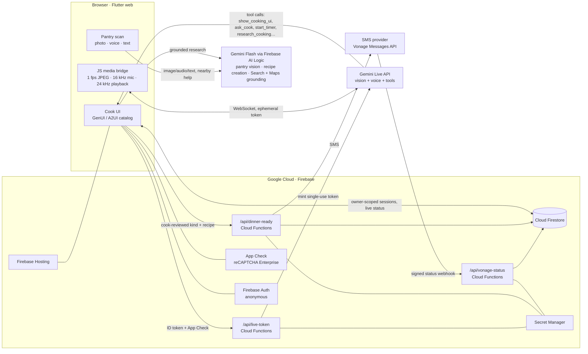

# SousSight

**What happens at the counter stays at the counter.**

SousSight is a cooking coach for people turning whatever they got from the food pantry, even a random mix, into a real meal. It can see the counter, listen and talk back, and it asks the cook instead of guessing.

Inspired by UCF's [garden-to-pantry work](https://www.ucf.edu/pegasus/how-does-your-garden-grow/) and [FreshU cooking demos](https://whps.sswb.ucf.edu/cooking-demos-classes/): getting groceries doesn't give you confidence at the counter, so SousSight coaches you through the cooking.

**Live app:** https://devfest-flutter-a59e8.web.app · Chrome on desktop or Android (Firefox isn't supported) · no account needed

## Hybrid AI: on-device when the device can, cloud when it earns it

> **Status: in progress for #BuildHybridAI 2026.** Nothing in this section is in the live app yet, and none of it has been run against a real on-device or cloud model. The live app today is the cloud build described under [What it does today](#what-it-does-today). Each item below is claimed only after its check on real hardware passes; the plan is in [PLAN.md](docs/buildhybridai/PLAN.md) and the design in [DESIGN.md](docs/buildhybridai/DESIGN.md).

The people SousSight is for often have limited data plans, patchy kitchen Wi-Fi, and photos of their home plus allergy details they'd rather not upload. So the next version runs as much as it can on the device, through Firebase AI Logic's hybrid inference:

- **Private by default.** What the camera sees is processed on the device when the device can.
- **Free and resilient.** Help keeps working when the signal drops or a cloud limit is reached.
- **Cloud when it earns it.** The live voice and vision coach, Google Search and Maps grounding, and anything the local model can't do.

| Feature (in progress) | Where it is meant to run |
|---|---|
| Pantry scan, typed list or photo | On-device first, cloud fallback. A voice clip is a separate cloud request, so it can't pull the photo to the cloud |
| AI recipe draft | On-device first; one cloud retry if the draft uses ingredients the cook didn't confirm |
| Local watch ("tell me when the mash looks right") | On-device only. If the view is unclear it asks for a better view, or for the cook's consent to send that one frame |
| Coach Lite (step questions without the live coach) | On-device; generated panels come from the same trusted catalog |
| Label check (allergens a label mentions) | On-device only. It reads the label; it can't confirm an allergen is absent |
| Research, nearby food help, live coach | Cloud (grounding and real-time audio and video) |

Planned platforms are Chrome on desktop (Gemini Nano), Android (Gemini Nano through the AICore developer preview) and iOS (Apple Foundation Models). A platform is listed as supported only after it passes its device check. Every result will show whether it came from the device or the cloud, and strict local-only mode overrides every retry and remote setting.

## What it does today

The live app is a cloud build. These eight steps run there now:

1. **Show what you got.** Scan your pantry haul with the camera, say it out loud, or type it. Gemini lists the items it thinks it sees; only the ones you tap count.
2. **Make a meal from it.** The main action is **Make a meal from these ingredients**: Gemini creates a recipe from exactly the items you confirmed, in the app's recipe format. It's checked before use, safety rules are applied in code, and it's labelled **AI-drafted · not reviewed**. Our reviewed recipes that fit are shown as alternatives. **Find food help nearby** uses Grounding with Google Maps to list nearby pantries and stores, linked to Google Maps.
3. **Cook with a live coach.** Gemini Live watches the camera and talks with you. It builds the cooking workspace on the fly as Flutter panels: step cues, comparisons, questions and timers.
4. **Allergy check first.** Before anything else, the coach asks whether anyone eating has an allergy to the recipe's allergens (for example peanut). If someone does, it researches a safe swap, and you confirm it.
5. **"Am I doing this right?"** Show the spread, the dice or the mash. The coach describes what it can see. When a fact is missing it asks you instead of guessing, and only your answer counts.
6. **Ask anything.** For questions like "Can I swap sunflower butter for peanut butter?", the coach runs a separate Google Search–grounded answer and shows the source links.
7. **Call everyone to the table.** You review a dinner-ready text before it goes out: "dinner's started", then "dinner is ready". The app tracks real delivery status, and if delivery fails it shows the reason and how to recover.
8. **You made it!** Finishing the last step shows a meal-complete moment. It lists the pantry items you confirmed, pauses the live coach to save cost, and offers three next steps: text the household (still reviewed), find food help nearby, or cook something else. It shows no invented impact numbers.

## Architecture (today)



In the hybrid design (in progress), every model call in the entry build goes through Firebase AI Logic, and one dispatcher in the app decides per request whether it runs on the device or in the cloud. The live coach moves to Firebase AI Logic on each platform where that passes its check; where it doesn't, that build ships without the live coach and offers Coach Lite instead. See [DESIGN.md §2](docs/buildhybridai/DESIGN.md#2-architecture).

## Tech stack

| Layer | Technology |
|---|---|
| App | Flutter web (3.47, Dart 3.13), Material 3, mobile-first layout |
| Generated UI | Flutter **GenUI** (`genui`, `a2ui_core`, A2UI v0.9). Gemini composes panels only from a trusted, schema-validated cooking catalog, never arbitrary code or HTML |
| Live vision and voice | **Gemini Live API** over WebSocket: camera frames, mic audio, native spoken replies, transcription, function calling, context-window compression and session resumption |
| Pantry scan, recipe creation, research and local help | **Gemini Flash via Firebase AI Logic**: multimodal structured output for pantry items and meal matches; **AI recipe creation** from any confirmed mix of ingredients, using the app's recipe schema; **Grounding with Google Search**, with source links and search suggestions; **Grounding with Google Maps** for nearby food help, listing only grounded places with Maps links |
| Hybrid inference (in progress) | Firebase AI Logic hybrid SDKs for Web, Android and iOS, behind an in-repo Flutter bridge (`packages/ai_logic_hybrid`, unofficial) |
| Identity and abuse protection | Firebase Anonymous Auth (no sign-up), **Firebase App Check** with reCAPTCHA Enterprise |
| Data | Cloud Firestore: owner-scoped sessions, server-only ledgers, emulator-tested security rules |
| Backend | Cloud Functions for Firebase (2nd gen, Cloud Run, Node 22): Live token minting, dinner-ready texts, delivery-status webhooks |
| Messaging | Vonage Messages API (SMS) with signed delivery-status webhooks |
| Secrets and operations | Google Secret Manager, Firebase Hosting, Cloud Billing budget and per-service caps |
| CI/CD | GitHub Actions (SHA-pinned) → Workload Identity Federation → Firebase deploy on every merge to `main`; gitleaks secret scanning |

## Routing and storage choices

**Routing: who handles each request.**
- Gemini Live decides *what* to do next by calling a tool. The app decides *whether it is allowed*: every tool call is schema-checked and deduplicated by its call ID before it touches app state.

| Tool | Routed to |
|---|---|
| `show_cooking_ui` | GenUI validator, then the Flutter surface. Bad output goes back to the model with the reason, so it can fix it |
| `ask_cook` | The cook, who is the human in the loop. Only an explicit answer becomes a confirmed fact |
| `research_cooking` | A separate Search-grounded Gemini request. Live custom tools and Search are kept apart, and citations come only from grounding metadata |
| `start_timer` / `watch_cooking` / `report_readiness` | Timers owned by the app with absolute deadlines; watches have IDs, so stale reports are rejected |
| `dinner_ready` | Opens a draft only. Sending always needs a separate, explicit cook action |

- Dinner-ready texts go to a Cloud Function. It checks Auth, App Check, session ownership and the recipient allowlist, and claims an idempotency ledger entry before calling the SMS provider. The provider then reports delivery to `/api/vonage-status`, which verifies the signature.

**Storage: what is kept where.**
- **Firestore `sessions/{id}`:** step progress, confirmed ingredients and facts, and the latest timer. Only the owner can read or write it. Fresh "New cook" sessions keep older ones intact.
- **`sessions/{id}/notifications/{nid}`:** a read-only delivery-status mirror that the dinner screen listens to.
- **Server-only collections:** token quotas, the send ledger and rate limits. Clients cannot read or write them.
- **Not stored:** camera frames, audio and transcripts. They stream to Gemini during the session and are never written to storage.
- **Credentials:** no long-lived Gemini or SMS-provider keys reach the browser. Live uses short-lived ephemeral tokens, and secrets live in Secret Manager. The Firebase web configuration in `lib/firebase_options.dart` is a public client identifier, not a secret; see [AUDIT.md](docs/buildhybridai/AUDIT.md#d-firebase-client-configuration).

## Dinner-ready text

The cook reviews every text before it goes out: a "dinner's started" text when cooking begins and a "dinner is ready" text at the end.
- **Delivery status:** a signed status webhook reports submitted → delivered or read, or rejected / undeliverable with the provider's reason, shown live in the app. A real text sent from the hosted app reached a phone, and the app showed Delivered ✓ from the signed callback.
- **Failures:** a clearly labelled demo action replays a rejected status (error 1120 Illegal Sender, a real failure hit during setup) through the same webhook handler. The app shows the reason and offers a new reviewed attempt, and never resends silently.
- **Real sends** go only to allowlisted numbers. Simulated delivered and failed outcomes are labelled as simulated.

## Cost guardrails

The hosted demo runs on a small fixed budget ($10 of Gemini usage and a $1.99 SMS trial balance):
- **Live sessions** stop automatically after a capped length, with a warning first, and also stop when idle.
- **Watch checks** run every 15 s and expire after a few minutes.
- **Video** frames are sent at low media resolution.
- **Live tokens** are rate-limited per user, per day and project-wide.
- **Texts:** real sends go only to allowlisted numbers. Simulated delivered and failed outcomes, clearly labelled and running through the real status handler, make repeat demos cost nothing.
- **Rehearsal mode** uses no paid services.

## Analytics

Production builds report usage to Google Analytics 4 through Firebase (free, measurement ID in `lib/firebase_options.dart`). GA records page views, sessions, countries and devices on its own; the app adds a few counts: `recipe_chosen`, `cook_session_started`, `live_coach_connected`, `step_completed`, `meal_completed`, `timer_started`, `watch_started`, `research_asked` and `household_message_sent`. Events carry only short labels such as recipe id, step number or message kind, never questions, pantry contents, names or phone numbers. AI-drafted recipes are reported as `ai_draft`. Rehearsal builds and tests log nothing (`lib/core/analytics.dart`). See the reports in the Firebase console under Analytics; ad blockers mean the counts run low.

## Safety boundaries

- **The cook is the human in the loop.** The coach asks when it doesn't know something, and the cook confirms ingredients, substitutions, progress and messages.
- **Camera appearance is not food safety.** It cannot establish internal temperature, freshness or the absence of an allergen, and the coach says so. This holds whether a model runs on the device or in the cloud.
- **Nothing is sent automatically.** No message goes out without the cook's explicit review, and no step is marked complete by the model alone.
- **AI-drafted recipes are labelled and constrained.** They're never presented as reviewed. Any heated step with meat, poultry, fish, shellfish or egg tells the cook to check doneness with a thermometer. Every heated step says the camera can't confirm doneness. Only the nine major allergens are listed.
- **Allergies come first.** The coach asks about allergens before giving guidance, and the camera can't confirm their absence.
- **Simulation is always labelled.** Rehearsal mode and simulated delivery are marked as simulated in the UI.

## Run it

```sh
flutter pub get
# Rehearsal (no credentials, simulated AI, labelled in the UI)
flutter run -d chrome -t lib/main_learner.dart --dart-define=FAKE_BACKEND=true
# Real services (see functions/README.md for backend setup)
flutter run -d chrome -t lib/main_learner.dart --web-port=7357 --dart-define-from-file=dart_defines.local.json
```

| Dart define | Purpose |
|---|---|
| `FAKE_BACKEND` | `true` runs the labelled rehearsal with in-memory services |
| `RECIPE_ID` | Default recipe for deep links. `?recipe=<id>` in the URL skips the pantry scan |
| `APPCHECK_DEBUG_TOKEN` | Development only; never in a published build |
| `RECAPTCHA_SITE_KEY` | Public reCAPTCHA Enterprise key for the hosted origin |
| `LIVE_TOKEN_URL`, `DINNER_MESSAGE_URL` | Optional absolute endpoints for local testing (the defaults are `/api/...` on the same origin) |
| `RESEARCH_MODEL` | Grounded research model override; also the default for `PANTRY_MODEL`, `NEARBY_MODEL` and `DRAFT_MODEL` |

The hybrid work adds more defines (`LIVE_BACKEND`, `DINNER_MODE`, `CLOUD_ROUTES`, `HYBRID_CLOUD_MODEL`); they are listed in [DESIGN.md §7](docs/buildhybridai/DESIGN.md#7-configuration) and documented here once they land.

Reviewed recipes are in `assets/recipes/`: Peanut Butter Sandwich, Smashed Chickpea Salad Wrap, and Black Bean & Corn Salsa. Any other mix of ingredients goes through the AI recipe creator (`lib/pantry/recipe_draft_client.dart`).

## Test

```sh
flutter analyze && flutter test
node --test test/live/browser_media_test.cjs
npm --prefix functions ci && npm --prefix functions test
npm --prefix test/rules ci && npm --prefix test/rules test   # Firestore emulator
./tool/build_web.sh --dart-define=FAKE_BACKEND=true
```

CI runs all of these on every pull request and deploys `main` to Firebase. Passing builds and fake-backend tests do not prove real camera, Gemini, on-device model or SMS behavior; that is recorded separately on the project cards.

## Self-hosting

You can run your own SousSight with your own keys. You pay for your own Gemini API usage, Firebase/Google Cloud project and SMS provider account; this project doesn't pay for or meter them. Start with **Run it** above, then follow [Backend and messaging setup](functions/README.md). Rehearsal mode needs no credentials.

The live app linked above is a demo deployment with the cost caps described in **Cost guardrails**. It is not a paid or supported service.

## Prior work

SousSight was first built between November 7 and 10, 2026. Everything up to commit `430747b` predates the hybrid work; [AUDIT.md](docs/buildhybridai/AUDIT.md) lists what was inherited, what is new, and the third-party media and attributions in this repository.

## License

SousSight is open source under the [GNU Affero General Public License v3.0](LICENSE) (`AGPL-3.0-only`). You can use, change and share it. If you run a modified version as a service for other people, you must offer those users your modified source under the same license.

The SousSight™ name, logo and icon aren't covered by the code license. See [TRADEMARKS.md](TRADEMARKS.md). To contribute, see [CONTRIBUTING.md](CONTRIBUTING.md); commits need a DCO sign-off.

Third-party photographs in `assets/reference-cooking/` keep their own Creative Commons licenses, listed with their authors in [reference-images.md](docs/validation/reference-images.md); they are evaluation fixtures and are not bundled into the app.

## More

- In the app, **How it works**, then **Under the hood**: the flow, the Google stack, privacy and safety, and protocol details
- [Product specification](docs/SPEC.md)
- [Hybrid plan](docs/buildhybridai/PLAN.md) · [Hybrid design](docs/buildhybridai/DESIGN.md) · [Prior-work and media audit](docs/buildhybridai/AUDIT.md)
- [Backend and messaging setup](functions/README.md)
- [Live transport](lib/live/README.md)
- [Peanut butter sandwich rehearsal checklist](docs/handoffs/CONFERENCE-PEANUT-BUTTER.md)
- [Cost ledger](docs/COST-LEDGER.md) · [Teardown plan](docs/TEARDOWN.md) · [Auto-deploy](docs/AUTODEPLOY.md)
