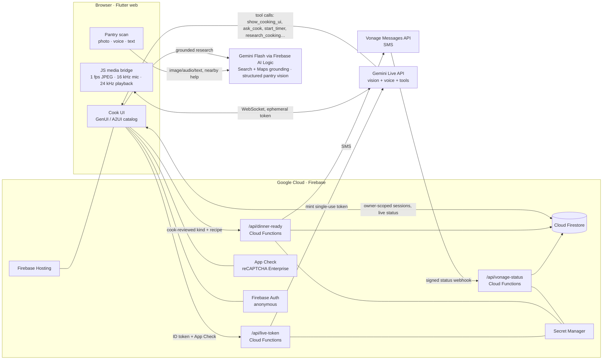

# SousSight

**Turn what you got from the food pantry into a meal, with a cooking coach that can see, listen and talk back.**

Inspired by UCF's [garden-to-pantry work](https://www.ucf.edu/pegasus/how-does-your-garden-grow/) and [FreshU cooking demos](https://whps.sswb.ucf.edu/cooking-demos-classes/), SousSight helps a novice cook turn pantry staples and fresh produce into a real meal. Getting groceries doesn't give you confidence at the counter, so SousSight coaches you through the cooking.

**Live app:** https://devfest-flutter-a59e8.web.app · Chrome on desktop or Android · no account needed

## The demo in seven beats

1. **Show what you got.** Scan your pantry haul with the camera, say it out loud, or type it. Gemini lists the items it thinks it sees; only the ones you tap count. It then suggests meals you can actually make and shows what's missing. **Find food help nearby** uses Grounding with Google Maps to list nearby pantries and stores, linked to Google Maps.
2. **Cook with a live coach.** Gemini Live watches the camera and talks with you. It builds the cooking workspace on the fly as Flutter panels: step cues, comparisons, questions and timers.
3. **Allergy check first.** Before anything else, the coach asks whether anyone eating has an allergy to the recipe's allergens (for example peanut). If someone does, it researches a safe swap, and you confirm it.
4. **"Am I doing this right?"** Show the spread, the dice or the mash. The coach describes what it can see. When a fact is missing it asks you instead of guessing, and only your answer counts.
5. **Ask anything.** For questions like "Can I swap sunflower butter for peanut butter?", the coach runs a separate Google Search–grounded answer and shows the source links.
6. **Call everyone to the table.** You review a Vonage SMS before it goes out: "dinner's started", then "dinner is ready". The app tracks real delivery status, and if delivery fails it shows the reason and how to recover.
7. **You made it!** Finishing the last step shows a meal-complete moment. It lists the pantry items you confirmed, pauses the live coach to save cost, and offers three next steps: text the household (still reviewed), find food help nearby, or cook something else. It shows no invented impact numbers.

## Architecture



## Tech stack

| Layer | Technology |
|---|---|
| App | Flutter web (3.47, Dart 3.13), Material 3, mobile-first layout |
| Generated UI | Flutter **GenUI** (`genui`, `a2ui_core`, A2UI v0.9). Gemini composes panels only from a trusted, schema-validated cooking catalog, never arbitrary code or HTML |
| Live vision and voice | **Gemini Live API** over WebSocket: camera frames, mic audio, native spoken replies, transcription, function calling, context-window compression and session resumption |
| Pantry scan, research and local help | **Gemini Flash via Firebase AI Logic**: multimodal structured output for pantry items and meal matches; **Grounding with Google Search**, with source links and search suggestions; **Grounding with Google Maps** for nearby food help, listing only grounded places with Maps links |
| Identity and abuse protection | Firebase Anonymous Auth (no sign-up), **Firebase App Check** with reCAPTCHA Enterprise |
| Data | Cloud Firestore: owner-scoped sessions, server-only ledgers, emulator-tested security rules |
| Backend | Cloud Functions for Firebase (2nd gen, Cloud Run, Node 22): Live token minting, dinner messages, Vonage status webhooks |
| Messaging | **Vonage Messages API** (SMS) with signed delivery-status webhooks |
| Secrets and operations | Google Secret Manager, Firebase Hosting, Cloud Billing budget and per-service caps |
| CI/CD | GitHub Actions (SHA-pinned) → Workload Identity Federation → Firebase deploy on every merge to `main`; gitleaks secret scanning |

## Routing and storage choices

**Routing: who handles each request.**
- Gemini Live decides *what* to do next by calling a tool. The app decides *whether it is allowed*: every tool call is schema-checked and deduplicated by its call ID before it touches app state.

| Tool | Routed to |
|---|---|
| `show_cooking_ui` | GenUI validator, then the Flutter surface. Bad output goes back to the model with the reason, so it can fix it |
| `ask_cook` | The cook, who is the human in the loop. Only an explicit answer becomes a confirmed fact |
| `research_cooking` | A separate Search-grounded Gemini request. Live custom tools and Search are kept apart, and citations come only from grounding metadata |
| `start_timer` / `watch_cooking` / `report_readiness` | Timers owned by the app with absolute deadlines; watches have IDs, so stale reports are rejected |
| `dinner_ready` | Opens a draft only. Sending always needs a separate, explicit cook action |

- Dinner messages go to a Cloud Function. It checks Auth, App Check, session ownership and the recipient allowlist, and claims an idempotency ledger entry before calling Vonage. Vonage then reports delivery to `/api/vonage-status`, which verifies the signature.

**Storage: what is kept where.**
- **Firestore `sessions/{id}`:** step progress, confirmed ingredients and facts, and the latest timer. Only the owner can read or write it. Fresh "New cook" sessions keep older ones intact.
- **`sessions/{id}/notifications/{nid}`:** a read-only delivery-status mirror that the dinner screen listens to.
- **Server-only collections:** token quotas, the send ledger and rate limits. Clients cannot read or write them.
- **Not stored:** camera frames, audio and transcripts. They stream to Gemini during the session and are never written to storage.
- **Credentials:** no long-lived Gemini or Vonage keys reach the browser. Live uses short-lived ephemeral tokens, and secrets live in Secret Manager.

## Vonage challenge mapping

> *"Vonage Messages API can send a status update when a request is accepted or resolved. Simulate a failed delivery to show how your app responds."*

| Challenge | SousSight |
|---|---|
| Status update when **accepted** | A "dinner's started" SMS the cook reviews, sent when cooking begins |
| Status update when **resolved** | A "dinner is ready" SMS the cook reviews |
| Delivery status | Signed Messages API status webhook: submitted → delivered or read, or rejected / undeliverable with Vonage's reason, shown live in the app |
| **Simulated failed delivery** | A clearly labelled demo action that replays a rejected status (error 1120 Illegal Sender, a real failure we hit during setup) through the same webhook handler. The app shows the reason and offers a new reviewed attempt, and never resends silently |

## Cost guardrails

The demo runs on a $10 Gemini budget and a $1.99 Vonage trial balance:
- **Live sessions** stop automatically after a capped length, with a warning first, and also stop when idle.
- **Watch checks** run every 15 s and expire after a few minutes.
- **Video** frames are sent at low media resolution.
- **Live tokens** are rate-limited per user, per day and project-wide.
- **Vonage outcomes** (delivered and failed) can be demonstrated without sending an SMS. They are clearly labelled simulated events that run through the real status handler.
- **Rehearsal mode** uses no paid services.

## Safety boundaries

- **The cook is the human in the loop.** The coach asks when it doesn't know something, and the cook confirms ingredients, substitutions, progress and messages.
- **Camera appearance is not food safety.** It cannot establish internal temperature, freshness or the absence of an allergen, and the coach says so.
- **Nothing is sent automatically.** No message goes out without the cook's explicit review, and no step is marked complete by the model alone.
- **Allergies come first.** The coach asks about allergens before giving guidance, and the camera can't confirm their absence.
- **Simulation is always labelled.** Rehearsal mode and simulated delivery are marked as simulated in the UI.

## Run it

```sh
flutter pub get
# Rehearsal (no credentials, simulated AI, labelled in the UI)
flutter run -d chrome -t lib/main_learner.dart --dart-define=FAKE_BACKEND=true
# Real services (see functions/README.md for backend setup)
flutter run -d chrome -t lib/main_learner.dart --web-port=7357 --dart-define-from-file=dart_defines.local.json
```

| Dart define | Purpose |
|---|---|
| `FAKE_BACKEND` | `true` runs the labelled rehearsal with in-memory services |
| `RECIPE_ID` | Default recipe for deep links. `?recipe=<id>` in the URL skips the pantry scan |
| `APPCHECK_DEBUG_TOKEN` | Development only; never in a published build |
| `RECAPTCHA_SITE_KEY` | Public reCAPTCHA Enterprise key for the hosted origin |
| `LIVE_TOKEN_URL`, `DINNER_MESSAGE_URL` | Optional absolute endpoints for local testing (the defaults are `/api/...` on the same origin) |
| `RESEARCH_MODEL` | Grounded research model override |

Bundled recipes are in `assets/recipes/`: Peanut Butter Sandwich, Smashed Chickpea Salad Wrap, and Black Bean & Corn Salsa.

## Test

```sh
flutter analyze && flutter test
node --test test/live/browser_media_test.cjs
npm --prefix functions ci && npm --prefix functions test
npm --prefix test/rules ci && npm --prefix test/rules test   # Firestore emulator
./tool/build_web.sh --dart-define=FAKE_BACKEND=true
```

CI runs all of these on every pull request and deploys `main` to Firebase. Passing builds and fake-backend tests do not prove real camera, Gemini or SMS behavior; that is recorded separately on the project cards.

## More

- In the app, **How it works**, then **Under the hood**: the flow, the Google stack, privacy and safety, and protocol details
- [Product specification](docs/SPEC.md)
- [Backend and messaging setup](functions/README.md)
- [Live transport](lib/live/README.md)
- [Conference quickstart](docs/handoffs/CONFERENCE-PEANUT-BUTTER.md)
- [Cost ledger](docs/COST-LEDGER.md) · [Teardown plan](docs/TEARDOWN.md) · [Auto-deploy](docs/AUTODEPLOY.md)
