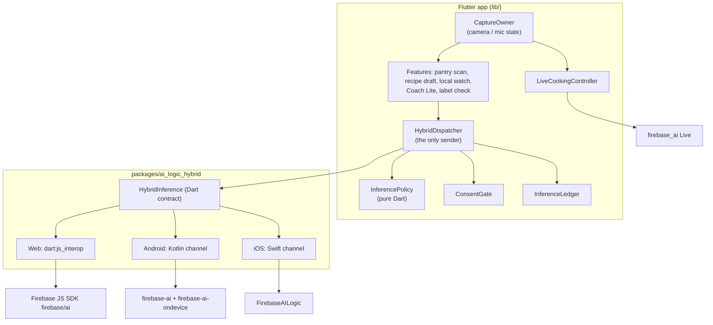

# #BuildHybridAI technical design

> **Status:** draft 3, 2026-11-25, revised after two Codex (`gpt-6.2-astra`) review rounds.
> Companion to [PLAN.md](PLAN.md): the plan says what and why; this says how.
> File and line references are to `origin/main` at `430747b`.
>
> **Evidence labels.** *Verified* = read from installed source or the shipped SDK bundle.
> *Docs* = stated in Firebase/Chrome/Flutter documentation, not yet run. *Unproven* = a design
> assumption a gate (§8) must confirm on real hardware. Nothing here has been run against a
> live model yet.

## 1. Picking up a card

1. Read [AGENTS.md](../../AGENTS.md), [PLAN.md](PLAN.md), then the section your card names.
2. `git fetch origin`. **Your local `main` may be stale** (on the original dev machine it is 42
   commits behind). Always start from the ref named in §9 and check it with `git rev-parse`.
   Until the plan and design PRs merge, these two documents exist only on branch
   `hybrid/00-design`; read them there.
3. Find your card in §9. Cards marked *human* or *gate* are not coding pickups. For the rest:
   the card must be in **Ready** with its dependencies Done. **Respect the GitHub assignee
   whatever the board status says**: take a card only if it is assigned to you or your operator,
   or was explicitly reassigned (AGENTS.md). Move it to **In progress** and comment that you have it.
4. Work in a worktree: `git worktree add -b <branch> .worktrees/<slug> <base ref from §9>`.
5. Build against `FakeHybridInference` and the contract in §4. Never call a cloud model from a test.
6. Run the checks in §11. Sign off commits (`git commit -s` adds the DCO trailer).
7. Open a PR against the PR target from §9, link the card, state the evidence level of each
   claim, move the card to **In review**. Do not merge. Never force-push.
8. If a fact here is wrong, tell the integration owner (card SS-083), who owns this file.

Toolchain: Flutter 3.47.9 (CI pin), Dart 3.13.7, Node for `functions/` and JS tests.

## 2. Architecture



Rules that hold everywhere:
- Every model call in the judged build goes through Firebase AI Logic. The judged build must
  not open `generativelanguage.googleapis.com` directly (§6, SS-074).
- **`HybridDispatcher` is the only code that sends a hybrid request**, including fallbacks and
  retries. Features describe what they want; the policy decides the mode.
- **No cloud call is made on a route G1 has not approved** (`CloudRoutes`, §5). This applies to
  every sender: the dispatcher, the Dart cloud clients, grounding, and Live.
- The plugin knows nothing about cooking. Privacy, consent and safety wording live in `lib/`.
- One `CaptureOwner` decides who holds the camera and microphone.

## 3. Platform facts

### Web (Chrome desktop)

| Fact | Evidence |
|---|---|
| `firebase_core_web` 4.1.0 loads Firebase JS SDK **13.1.0** by dynamic `import()` from `https://www.gstatic.com/firebasejs/<v>/firebase-<service>.js` and stores the app module on `window.firebase_core` | Verified (installed source) |
| `firebase-ai.js` exists at 13.1.0 and imports `firebase-app.js` from the same path | Verified (bundle). That `getApp()` then shares FlutterFire's App Check instance is **Unproven** (G2) |
| Exports include `getAI`, `getGenerativeModel`, `GoogleAIBackend`, `InferenceMode`, `InferenceSource`, `Schema`, `getLiveGenerativeModel` | Verified (bundle) |
| `InferenceMode` values: `prefer_on_device`, `only_on_device`, `only_in_cloud`, `prefer_in_cloud`. `InferenceSource`: `on_device`, `in_cloud` | Verified (bundle) |
| Hybrid config is `getGenerativeModel(ai, { mode, inCloudParams, onDeviceParams })`. **Top-level config is ignored when `mode` is set.** Default cloud model `gemini-3.5-flash-lite`. Config is per model instance | Verified (bundle) |
| Local defaults: `createOptions.expectedInputs = [text(en), image]`, `expectedOutputs = [text(en)]`, so a default instance asks for image capability even for text | Verified (bundle) |
| Local calls are `session.prompt(messages, onDeviceParams.promptOptions)`. The SDK does **not** forward `responseSchema` or `systemInstruction` to the local model (`responseConstraint` and `initialPrompts` appear nowhere in the bundle). The bridge supplies `promptOptions.responseConstraint` and `createOptions.initialPrompts` itself | Absence verified; the working shape is **Unproven** (G2) |
| `model.initializeDeviceModel(cb)` starts the download; `cb` gets a 0–1 fraction; needs a user gesture | Verified (bundle) + Docs |
| `prefer_on_device` uses the local model only when availability is `available` and the request is compatible; otherwise cloud, including while downloading. `only_on_device` throws when no local model | Verified (bundle) |
| Limits: single turn, ~9,216 tokens, no audio/tools/grounding/Live locally. Image input needs `chrome://flags/#prompt-api-for-gemini-nano-multimodal-input`. Chrome on Android unsupported | Docs |

### Android

| Fact | Evidence |
|---|---|
| `firebase-ai:18.2.0` + `firebase-ai-ondevice:16.0.0-beta08` (not in the BoM); minSdk 26; `@OptIn(PublicPreviewAPI::class)` | Docs |
| `firebase_core` 5.1.0 pins BoM **35.1.0**; whether the on-device artifact resolves against it is **Unproven** (G4) | Verified pin |
| `generativeModel(modelName, onDeviceConfig = OnDeviceConfig(mode, …, modelOption))`; cloud model name mandatory | Docs |
| `FirebaseAIOnDevice.checkStatus()` and `.download()` (Flow); no automatic download | Docs |
| Gemini Nano 4 is `OnDeviceModelOption.PREVIEW` / `PREVIEW_FAST` and needs AICore Developer Preview enrollment; default `STABLE` is Nano 2/3 | Docs |
| Limits: text + one Bitmap, JSON output, **4,000 tokens for the whole request**, aim for ≤256 output tokens, foreground only, `BUSY` and battery-quota errors, English/Korean validated | Docs |
| Release build signs with the debug config (`android/app/build.gradle.kts`); the manifest declares no camera or mic permission | Verified |

### iOS

| Fact | Evidence |
|---|---|
| Hybrid needs Firebase Apple SDK ≥12.13.0 and SPM | Docs |
| `firebase_core` 5.1.0's SPM manifest pins `firebase-ios-sdk` to **exactly 13.1.1** | Verified. That `FirebaseAILogic` links and runs beside it under the Runner's iOS 15 target is **Unproven** (G5) |
| `HybridModel(primary:secondary:)` with `FirebaseAI.SystemLanguageModel.default` and `ai.geminiModel(name:)`; a session can also take a single model; docs disagree on the call shape | Docs (conflicting) |
| Source: `response.rawResponse.modelVersion == "apple-foundation-models-system-language-model"` when local | Docs |
| Limits: **text only**, 4,096 tokens, foreground only; treat output as plain text and validate in Dart | Docs |
| `lib/firebase_options.dart` throws for iOS and no iOS config is checked in. Whether an iOS app is registered in the console is not known | Verified (repo only) |

### Live, App Check, cost

| Fact | Evidence |
|---|---|
| Every real build uses `EphemeralGeminiLiveTransport` (`lib/learner/cooking_app.dart:149`), which opens `generativelanguage.googleapis.com` (`lib/live/ephemeral_live_transport.dart:88`) | Verified |
| On web, the JS SDK and `firebase_ai` open the Live socket with only `?key=`; no App Check token is sent. Backend behaviour under enforcement is undocumented | Verified (source); outcome **Unproven** (G3) |
| On native, `firebase_ai` sends App Check and Auth headers on the Live handshake | Verified (`live_session.dart`) |
| Client `kLiveModel` (`lib/live/live_tools.dart:7`) and server `LIVE_MODEL` (`functions/src/live-token.js:5`) default to different models | Verified |
| Quotas are enforced only at token mint: `createQuotaReservation(db)` in `functions/src/token-quota.js`, called with a verified UID | Verified |
| While connected, `LiveCookingController` forwards each camera frame to the transport (`lib/live/live_controller.dart:153-159`) | Verified |
| `web/soussight_live.js:59` requests camera **and** microphone in one `getUserMedia` call; `LiveMedia` has no camera-only mode | Verified |
| Billing is enabled on the project; caps are delayed; credit coverage is unverified (`docs/COST-LEDGER.md`) | Verified (repo record) |
| CI defaults `ENABLE_DINNER_MESSAGES` and `ALLOW_DELIVERY_SIMULATION` to `false` unless repo variables say otherwise | Verified (workflow); deployed values **Unproven** (G1) |

## 4. Bridge contract (`packages/ai_logic_hybrid`)

Card SS-061 implements this section and owns the plugin's `pubspec.yaml`, its `lib/` (except
`lib/src/web/`) and plugin registration metadata. This file has one writer, the integration
owner (SS-083): to change the contract, ask them to change this section first.

```dart
enum HybridMode { preferOnDevice, onlyOnDevice, preferInCloud, onlyInCloud }
enum InferenceSource { onDevice, cloud }
enum OnDeviceStatus { available, downloadable, downloading, unavailable }
enum AndroidModelOption { preview, previewFast, stable }

/// Set once, before first use. Status, download and generation all use it.
class HybridConfig {
  final String cloudModel;                 // from HYBRID_CLOUD_MODEL
  final AndroidModelOption androidModel;   // judged build: preview (Gemini Nano 4)
  final List<String> languages;            // e.g. ['en']
}

/// Limits of the LOCAL model only. Cloud requests are not bound by these.
class LocalModelLimits {
  final String modelFamily;             // 'Gemini Nano' | 'Apple Foundation Models'
  final bool supportsImage;             // false on iOS
  final bool supportsJsonSchema;        // false on iOS
  final int maxTotalTokens;             // prompt + output: 9216 / 4000 / 4096
  final int defaultOutputReserve;       // tokens held back for the answer
  final int imageTokenEstimate;         // budget charged per image (Unproven; start at 1000)
  final List<String> validatedLanguages;
}

class HybridCapabilities {
  final String platform;                // 'web' | 'android' | 'ios' | 'none'
  final LocalModelLimits? local;        // null when there is no local model or no bridge
  final int maxImages;                  // any route: 1
  final int maxImageBytes;              // any route: 1 MB
  final int maxImageDimension;          // any route: 768 px
  final Set<HybridMode> supportedModes; // empty when the bridge could not initialize
}

class HybridAvailability {
  final OnDeviceStatus status;
  final String? reason;      // unsupported_browser, bridge_unavailable, device_not_eligible,
                             // apple_intelligence_off, model_not_ready, not_enrolled, ...
  final String? modelLabel;  // exact base model name when the platform reports it
}

sealed class HybridPart {}
class HybridText extends HybridPart { final String text; }
class HybridInlineData extends HybridPart { final Uint8List bytes; final String mimeType; }

/// What a feature asks for. It carries no mode: the dispatcher sets it.
class HybridTask {
  final String feature;                    // 'pantry_scan', 'local_watch', ...
  final String? systemInstruction;
  final List<HybridPart> parts;            // single turn
  final Map<String, Object?>? jsonSchema;  // JSON Schema subset, below
  final int maxOutputTokens;
  final Duration timeout;
}

/// What the plugin receives. Built only by HybridDispatcher.
class HybridRequest {
  final String requestId;                  // for cancel and stale-result checks
  final HybridMode mode;
  final HybridTask task;
}

class HybridResult {
  final String requestId;
  final String text;
  final InferenceSource source;   // the SDK's own report, never inferred
  final String? modelLabel;       // observed model name if the SDK exposes one, else null.
                                  // Never the requested option presented as an observation.
}

enum HybridErrorCode {
  unavailable, unsupportedInput, unsupportedMode, busy, quota, blocked,
  network, attestation, timeout, cancelled, failed,
}
class HybridException implements Exception { final HybridErrorCode code; final String message; }

abstract class HybridInference {
  Future<void> configure(HybridConfig config);
  Future<HybridCapabilities> capabilities();
  Future<HybridAvailability> availability({required bool withImage});
  Stream<double?> prepare({required bool withImage});  // 0..1, null if unknown; see rules
  Future<HybridResult> generate(HybridRequest request);
  Future<void> cancel(String requestId);
}
```

Contract rules:
- **Never throws for a missing bridge.** If the JS asset, the SDK import or the native plugin
  fails to initialize, `capabilities()` returns `platform: 'none'`, `local: null`, empty
  `supportedModes`, and `availability` returns `unavailable` / `bridge_unavailable`. The
  dispatcher can then still decide (cloud adapter if permitted, otherwise stop).
- **Availability is per modality.** A profile where text works and images do not must report
  `available` for `withImage: false` and something else for `withImage: true`.
- **Web model instances are keyed by the full configuration**: mode, modality, cloud model,
  system instruction, schema, output limit. Never reuse an instance across a different key;
  mode, `initialPrompts` and `promptOptions` all live on the instance. Download readiness is a
  separate, per-modality fact.
- **`prepare` starts work at call time, not on listen**, so on web it runs inside the tap that
  called it; the bridge script is loaded at app start. The stream is broadcast, emits fractions,
  completes when the model is ready and errors with `HybridException`. A download cannot be
  cancelled. iOS has nothing to download: the stream completes at once and `availability` says why
  if the model is not usable.
- **Modes are never widened.** `onlyOnDevice` never reaches the cloud. A backend that cannot
  honour a mode throws `unsupportedMode`.
- **`source` comes from the SDK.** If it cannot be read, throw `failed`.
- **Timeout and cancel.** `generate` completes or throws `timeout` within `task.timeout`.
  `cancel` stops the work where the platform allows; where it cannot, the backend completes the
  call with `cancelled` and discards the late result.
- **Attachment limits apply to every route** and are enforced in the plugin (`unsupportedInput`
  before any SDK call). **Local limits apply only to a local run**: an `onlyInCloud` request with
  a photo is valid on iOS. If the native hybrid session cannot carry an attachment to the cloud,
  the backend throws `unsupportedInput` and the dispatcher sends it with the Dart cloud client.
- **Token budget:** (system instruction + all text parts + serialized schema) characters / 4,
  plus `imageTokenEstimate` per image, plus `maxOutputTokens`, must be ≤ `maxTotalTokens` for a
  local run. The policy uses this to choose a route; the plugin rejects an `onlyOnDevice`
  request that exceeds it.
- **Schema:** only `type`, `properties`, `required`, `items`, `enum`, `minItems`, `maxItems`,
  `description`, lowercase types. Web cloud → `inCloudParams.generationConfig` with **both**
  `responseMimeType: 'application/json'` and `responseSchema`; web local →
  `promptOptions.responseConstraint`; Android → the SDK schema type; iOS local → appended to the
  prompt, caller validates.

Mode mapping per platform:

| Mode | Web | Android | iOS |
|---|---|---|---|
| `preferOnDevice` | `mode: prefer_on_device` | `OnDeviceConfig(PREFER_ON_DEVICE)` | `HybridModel(primary: system, secondary: cloud)` |
| `onlyOnDevice` | `only_on_device` | `ONLY_ON_DEVICE` | session with the system model alone |
| `onlyInCloud` | `only_in_cloud` | `ONLY_IN_CLOUD` | session with the cloud model alone |
| `preferInCloud` | `prefer_in_cloud` | `PREFER_IN_CLOUD` | `unsupportedMode` unless the SDK is shown to support cloud-primary |

Wire format. Method channel `dev.soussight/ai_logic_hybrid`, event channel
`dev.soussight/ai_logic_hybrid/prepare`. Enum values travel as their Dart names
(`preferOnDevice`, `available`, …). `validatedLanguages` and `supportedModes` are lists of strings.

| Method | Arguments | Returns |
|---|---|---|
| `configure` | `{cloudModel, androidModel, languages}` | null |
| `capabilities` | none | map of the `HybridCapabilities` fields |
| `availability` | `{withImage}` | `{status, reason?, modelLabel?}` |
| `generate` | `{requestId, mode, feature, systemInstruction?, parts:[{type:'text',text} \| {type:'inlineData',mimeType,bytes}], jsonSchema?, maxOutputTokens, timeoutMs}` | `{requestId, text, source, modelLabel?}` |
| `cancel` | `{requestId}` | null |
| event stream (arg `{withImage}`) | | `{fraction: double?}` until done |

Errors are `PlatformException` whose `code` is a `HybridErrorCode` name.

Web: a JS file shipped as a plugin asset, loaded at startup via
`ui_web.assetManager.getAssetUrl(...)`, exposing `globalThis.aiLogicHybrid` with `configure`,
`capabilities`, `availability`, `generate`, `cancel` (all returning promises) and
`prepare({withImage}, onProgress)`, which starts initialization synchronously and returns a
promise that settles when the model is ready. It reads the SDK version from `globalThis.firebase_core.SDK_VERSION` and takes an
injectable importer so `node --test` can stub `firebase-ai.js` and `LanguageModel`
(pattern: `test/live/browser_media_test.cjs`).

`FakeHybridInference` is scriptable per call (capabilities, availability, results, errors,
delays) and records every request. Rehearsal mode uses it and keeps the `SIMULATED` labels.

## 5. Dispatcher, policy, consent, ledger (`lib/ai/hybrid/`)

```dart
/// Cloud routes G1 approved for this build. Compiled in; default is none.
enum CloudRoute { hybridFallback, research, nearby, live }
class CloudRoutes { bool allows(CloudRoute route); }   // from --dart-define=CLOUD_ROUTES=...

abstract class PrivacySettings { bool localOnly(String feature); }  // read live, never cached

class RouteInput {
  final String feature;
  final bool hasImage, hasAudio, hasLocation;
  final int estimatedTokens;        // §4 token budget
  final String languageTag;
  final bool localOnly;
  final bool online;
  final bool cloudApproved;         // CloudRoutes.allows(hybridFallback)
  final HybridCapabilities capabilities;
  final OnDeviceStatus status;      // for this request's modality
  final RemoteRouting? remote;      // optional overrides (SS-076)
}

class RouteDecision {
  final HybridMode? mode;           // null = cannot run; show reason and next step
  final RouteReason reason;         // enum, one cook-facing sentence each
  final bool mayUpload;             // true for every mode except onlyOnDevice
  final bool needsConsent;
}
RouteDecision decideRoute(RouteInput input);    // pure, table-tested

/// Consent is for one exact payload in one session, and is used once.
class ConsentAsk { final String feature; final Set<DataKind> kinds;
                   final String payloadDigest; final String sessionId; }
abstract class ConsentGate { Future<ConsentGrant?> request(ConsentAsk ask); }
enum DataKind { text, image, audio, location }

enum Provenance { sdkOnDevice, sdkCloud, cloudAdapter, simulated, unknown }
class InferenceLeg {
  final String requestId; final String feature; final HybridMode? mode;
  final Set<DataKind> kinds; final bool transferPermitted;
  final Provenance provenance; final HybridErrorCode? error;
}
class DispatchResult {
  final String? text;               // null when blocked or failed
  final List<InferenceLeg> legs;    // every attempt, in order
  final RouteReason? blocked;
}
/// Returned synchronously, before the first await.
class HybridOperation {
  final String operationId;
  final Future<DispatchResult> result;
  void cancel();                    // stops the current send and any later fallback or retry
}
```

Precedence in `decideRoute`, highest first: `localOnly` → `cloudApproved` → hard limits (audio,
image where the local model has none, token budget, language, `supportedModes`) → availability
→ remote overrides → feature default (PLAN §4).
- `localOnly` can only yield `onlyOnDevice` or `null`. Remote Config cannot loosen it.
- **`cloudApproved == false` also only yields `onlyOnDevice` or `null`**, because
  `preferOnDevice` may fall back inside the SDK. If G1 approves no hybrid fallback route, the
  entry cannot demonstrate the contest's defining behaviour: record a go/no-go on SS-055.

`HybridDispatcher.start(task, {validate})` returns a `HybridOperation` and is the only sender.
Before **every** send (first attempt, Dart cloud fallback, semantic retry) it checks, in order:
the operation is not cancelled; `PrivacySettings.localOnly` as it is **now**; `CloudRoutes`; and,
when the send may upload and consent is needed, a `ConsentGrant` matching this payload digest
and session. Then:
1. Decide. `mode == null` → return `blocked`; nothing is sent.
2. Write the leg to the ledger (kinds, `transferPermitted`), then call the plugin.
3. Record the outcome: SDK source → `sdkOnDevice` / `sdkCloud`; an error on a send that was
   allowed to upload → `unknown` (whether data left is not known).
4. Bridge unavailable or `unsupportedInput` on a cloud-only attachment: send with the existing
   Dart `firebase_ai` client only if the checks above pass; provenance `cloudAdapter`.
5. Semantic retry: if `validate` rejects an **on-device** result and the checks pass, send once
   with `onlyInCloud` as a new leg, and validate that too. Transport errors are not retried this way.

A result shown to the cook carries its legs. A scan built from a local photo leg and a cloud
voice leg shows both, never one merged badge.

**What consent binds (SS-096).** A `ConsentGrant` binds `hybridPayloadDigest(task)`: the task
as the app built it (the exact bytes the cook was shown), for one session, used once. It does not
bind the bytes an SDK puts on the wire. With `preferOnDevice` on Android, the bridge decodes an
image to a `Bitmap` for Gemini Nano (`FirebaseHybridEngine.generate`); if the SDK then falls
back to the cloud, it re-encodes that `Bitmap`, so the bytes sent are the same picture but not
the digested bytes. `onlyInCloud` sends the original bytes (`inlineData`). Therefore:
- When the local model is not ready (`downloadable`, `downloading`, `unavailable`) and the payload
  needs consent, `decideRoute` returns `onlyInCloud`, not `preferOnDevice`: it would reach the
  cloud either way, and this way the exact allowed bytes go.
- When the local model is ready, a consented photo still runs `preferOnDevice`, so it is answered
  on the device whenever it can be. If the SDK falls back, the cloud receives a re-encoding of the
  allowed picture. The consent prompt and ledger describe the picture and its kinds, which stay
  true; nothing else is added. The web bridge hands the JS SDK the original bytes; whether the
  SDK re-encodes them on its own fallback has not been verified.
- Only a `ConsentGate` can issue a `ConsentGrant` (`ConsentGate.issue`, `@protected`); feature
  code cannot construct one.

A sub-step's `parentFeature` local-only setting applies to it (`localOnlyFor`): the watch's
cloud check follows "Keep Watch my food on this device", and the pantry voice clip follows
"Keep Pantry scan on this device" (the clip then never uploads and the scan says so).

`ConfiguredHybridInference` waits for the startup `configure` (on web, an unbounded `import()`)
at most `task.timeout` in `generate` and `configureWait` in `capabilities`, then throws
`HybridException(timeout)` without forwarding the request.

`InferenceLedger` is session-scoped, in memory, and holds legs. Other cloud senders also check
`CloudRoutes` and write a leg (`cloudAdapter`): Live connect **and each resume**, grounded
research and its follow-ups, and nearby lookups, which send **location**. `GeminiNearbyClient`
reads its `NearbyGate` immediately before every send: `CloudRoute.nearby`, the cook's "Keep Find
food help on this device" switch (feature `nearby`) and connectivity. A blocked or invalid search
is a leg that was not allowed to leave; a send is a pending `{location, text}` leg, confirmed when
Gemini answers and left unknown when it fails. Without an approved route (or, in real mode,
without a client wired to the runtime) the "Find food help nearby" entry points are hidden, and
How it works lists nearby as off. Research lives in Jenna's files
(`lib/learner/research_panel_client.dart` calls into `lib/research/`): add the hook at the call
site in shared code, not inside her files. The ledger view separates "allowed to leave" from
"reported as sent", and states what the session saves to Firestore and that the Live coach is
given the cook's confirmed facts and allergy context.

## 6. Feature designs

### SS-083 Gate harness and integration (do this first)
- `lib/main_hybrid_gate.dart`: a debug entry point that initializes Firebase + App Check
  exactly as the real app does, then offers fixed probes that call the **plugin directly**
  (bypassing the policy) and print the raw adapter, mode, cloud model, a request fingerprint
  (hash of the task), SDK-reported source, model label and latency.
- Probes: text; text with a schema whose enum excludes the natural answer; text with a system
  instruction containing a codeword; a live camera frame with a step cue; an obscured frame.
- The harness is for diagnosis. It does not replace the production-path gate (G2c, §8).
- This card's owner is the **integration owner**: the single writer of the shared files (§9) and
  of this document, and keeper of `hybrid/integration`, the trunk every branch starts from and
  targets. Shared interface changes (for example the `LiveMedia` additions in SS-067) land on the
  trunk first, as small PRs, before the branches that implement them.

### SS-065 Hybrid pantry scan
- Seams: `PantryGenerator` in `lib/pantry/pantry_client.dart`; `parsePantryResult` in
  `lib/pantry/pantry_models.dart` (takes one JSON string, requires `items` and `meals`).
- `lib/pantry/pantry_screen.dart:270` sends text, photo and audio as one `PantryInput`. New flow:
  1. If there is a voice clip: cloud request with an **items-only** schema. Validate it alone.
     If it fails, continue without it and tell the cook.
  2. One ranking request through the dispatcher: typed text + voice-derived item names + photo.
     Only this leg produces `meals`, so there is one ranking and one `parsePantryResult` call.
- The ranking task has its own compact schema and output budget (the current 8,192-token +
  thinking config is cloud-only). A complete valid example must fit in the Android budget; add it as a test.
- `PantryResult` gains `List<InferenceLeg> legs`.

### SS-066 Recipe draft
- `GeminiRecipeDraftClient.draft` (`lib/pantry/recipe_draft_client.dart:139`) has
  `request.confirmedItems`; `buildDraftRecipe` (`:231`) does not. New validator, used for both
  attempts: the schema gives every ingredient a `fromConfirmed` field whose enum is the cook's
  confirmed items plus `basic`. A **required** ingredient must reference a confirmed item; salt,
  pepper, oil and water use `basic` and must be `optional` unless confirmed, as the existing
  prompt already demands. No fuzzy name matching: "milk" must not pass because the cook
  confirmed "coconut milk". Test a canned-item match and a shared-token substitute.
- `RecipeDraftClient.draft` returns `Recipe`; add the legs via a wrapper result type.

### SS-067 Local watch (hero)
- **Capture.** `web/soussight_live.js` needs a separate video-only initialization path: today it
  always builds the audio worklet and calls `createMediaStreamSource(stream)` (`:70-96`), which
  fails on a stream with no audio track. `LiveMedia` gains `startCameraOnly()` and
  `Stream<CapturedFrame> timedFrames` (`bytes`, `capturedAt` stamped at acquisition). Covered in
  `test/live/browser_media_test.cjs`, including frames arriving with audio creation disabled.
- **One owner.** `CaptureOwner` states: `off`, `localCamera`, `liveAv`. Transitions release the
  previous capture first, and a late acquisition cannot publish after a handoff. The pantry
  screen's own capture (`lib/pantry/pantry_screen.dart:129`) goes through the same owner.
- **Loop.** `LocalWatchController` in `lib/watch/`: single-flight (never start a check while one
  is running), use only a frame whose `capturedAt` is under 2 s old, `onlyOnDevice`, schema
  `{state: ready|not_yet|unsure, whatISee}`, where `ready` means "matches the step's visible cue".
  Keep the `HybridOperation` and call `cancel()` on Stop, step change, session change,
  backgrounding, Live connect and the 3-minute limit. Verdicts carry watch id + step id + session id and are dropped if any differ.
- **Unsure.** Ask for a better view. Sending that single frame to the cloud needs a
  `ConsentGrant` for that frame's digest; a different frame needs a new one.
- **One entry point.** The "Watch my food" button, app lifecycle handling
  (`lib/learner/cooking_app.dart:330`, `:638`, `:727`) and the model-initiated `watch_cooking`
  tool (`lib/live/live_controller.dart:405`) all go through one coordinator method that picks
  local or Live watch and states which. Status text must not say "Camera and microphone off"
  (`cooking_app.dart:736`) during a local watch.
- Web and Android only. On iOS the action says the local model can't see images and offers the
  Live watch, labelled as cloud.
- Tests include: mic denied with camera granted; Stop and a privacy-setting change while a
  consent prompt is open; zero outbound frames over HTTP **and** WebSocket.

### SS-068 Coach Lite
- `CookingCoordinator.say` (`:214`) returns early when Live is inactive, and the composer only
  clears text when Live is active (`cooking_app.dart:346`). Add the Live-off branch.
- Prompt: current step (title, instruction, cue), ingredients, confirmed facts, the question.
  Bounded to the platform budget.
- Output: `{components: [...], timerSuggestion?: {label, seconds}}`. `components` must be a valid
  catalog payload with the required `CookingColumn` root, restricted to a **lite allowlist**
  added to `lib/genui/cooking_ui_contract.dart` (display components and the actions `next_step`
  and `ask_cook`), checked before `validateCookingUi`, which accepts the full catalog.
- The catalog's `cookingTimer` only displays a timer that already exists, so a panel cannot
  start one. `timerSuggestion` is handled by the app: it clamps `seconds` to 60–3600 and shows
  its own "Start timer" control. One tap by the cook calls `CookingCoordinator.startTimer`
  (`:372`); the running timer then appears through the existing timer UI. Test the whole path
  from model JSON to a ticking timer.
- Guard: the app, not the model, stamps each request with session id, coordinator epoch, step id
  and a sequence number; only the newest matching response is applied.
- Factual questions go to grounded research only if the dispatcher's decision for this question
  allows an upload; with `localOnly` or offline, the answer says it can't check sources.

### SS-069 Label check
- `lib/label/`. Photo → `onlyOnDevice` → `{allergensMentioned: [...], readable: bool}` limited to
  `kDraftAllergens`. An unreadable label or empty list says "I couldn't read an allergen
  statement. That doesn't mean there are none." Household allergens for this feature stay in
  local storage; the screen notes that allergy answers given to the coach are part of the saved session.
- iOS: typed-label path, or `ConsentGate` for the photo.

### SS-070 / SS-071 Trust surface and first-run states
- Widgets in `lib/trust/`: per-leg source badges, ledger view, "On-device AI" sheet.
- `AppReadiness` combines `HybridAvailability` with things the plugin cannot know: camera
  permission, connectivity, App Check failure (`attestation`), provider quota. Each state has a
  message and a next action.

### SS-072 Offline (scope decided: an already-open cooking session)
- Today `advanceStep` awaits a Firestore transaction before changing the workspace
  (`lib/learner/cooking_coordinator.dart:290-310`); the session listener overwrites `session`
  with every snapshot (`:128`); the last step clamps its index, so "next" equals "current".
- Step changes become operations `{opId, kind: advance|complete, expectedStepId, timerEndsAt?}`.
  They apply locally at once and stay in a pending list that is **re-applied on top of every
  incoming snapshot**, so a cached or reconnect snapshot cannot roll the screen back.
- On reconnect each operation is saved in one transaction that also appends its `opId` to a
  bounded `appliedOpIds` list on the session; an operation whose `opId` is already there, or
  whose `expectedStepId` no longer matches, is dropped. Completion is its own `kind`, so a
  retried final step cannot apply twice. Timer end times travel in the operation.
- Tests: cut network → Coach Lite answer → advance → start timer → reconnect → exactly one
  transition and the original deadline; a stale snapshot mid-flight; a lost acknowledgement on
  the **last** step. Reopening the app offline is out of scope.

### SS-073 Native runtime
- `NativeLiveMedia implements LiveMedia` (`lib/live/live_types.dart:65`), including camera-only.
- iOS Firebase app (`flutterfire configure`), permissions, native App Check providers, real
  release signing (`ios/Runner.xcodeproj`, Android signing via the integration owner). No debug
  token in the repo or in a shipped build.

### SS-074 Live through AI Logic
- New dart-define `LIVE_BACKEND` with values `aiLogic`, `ephemeral`, `none`. **A missing or
  unknown value means `none`.** One factory, used by `lib/learner/cooking_app.dart:149`, reads it.
- The judged build never uses `ephemeral`: CI validates the resolved configuration before
  compiling and fails otherwise. Native uses `aiLogic`. Web uses `aiLogic` if G3 passes,
  otherwise `none` (Live controls hidden, Coach Lite offered). The legacy coach can only live in
  a separate build that is not the entry.
- With `ephemeral` off, the judged deploy drops the `liveToken` function target and the
  `/api/live-token` rewrite.
- Session reservation: a `liveSession` function requiring **Auth and App Check**. It calls the
  function returned by `createQuotaReservation(db)` with the verified `uid` and a
  **server-side** `Date.now()`. Export it from **every** entry point CI can select
  (`functions/src/index.js`, `live-index.js`, `live-dinner-index.js`; see
  `.github/workflows/firebase.yml:173`). Native has no Hosting origin for a relative URL, so the
  client takes an absolute `LIVE_SESSION_URL` define, like `LIVE_TOKEN_URL` in
  `lib/data/live_token_provider.dart`. The client calls it before `connect`, not on resume.
  Test an authorized and a denied connect against the packaged configuration.
- This is an app-level check: a modified client could skip it. Provider-side rate limits for AI
  Logic are the real ceiling and are confirmed in G1.

### SS-075 Evidence
- Read (never modify) the eight labelled photos and `fixtures.json` in
  `assets/reference-cooking/`. Each fixture has `expectedOutcome`, `expectedObservations` and
  `expectedAdjustmentId`. Scoring is fixed before running and has three parts per fixture:
  1. verdict class: `matchesTarget` ↔ `ready`, `needBetterView` ↔ `unsure`, `adjust` ↔ `not_yet`;
  2. observation: `whatISee` states the fixture's expected observable fact and not its opposite;
  3. action: what the cook would do next matches `expectedAdjustmentId`. An over-mashed bowl
     whose adjustment is "fine as is" must not lead to "keep mashing", so the watch schema gains
     `direction: more|less|none` for `not_yet`.
  Report each part over all eight, plus correct abstentions, latency and frames uploaded.
- One filmed cook-through in a kitchen not used for the fixtures, with an obscured bowl, the
  cook's correction, measured frames uploaded and completion after the connection drops.
  Cook acceptance records are Jenna's (§10); coordinate through her card.

### SS-084 Judge-safe dinner message
- Today the real build always uses `sendDinnerMessage`; the simulated sender is tied to
  app-wide `isDemo` (`lib/learner/cooking_app.dart:266-282`), the review sheet requires a phone
  number (`lib/learner/dinner_review.dart:145`), and the server allowlists it before simulating
  (`functions/src/dinner-ready.js:89`). A judge has no usable path.
- New dart-define `DINNER_MODE`: `real` or `simulated`, independent of `FAKE_BACKEND`.
  `simulated` uses the existing `FakeDinnerBackend` as sender and status source, with a fixed
  fictional recipient ("Demo household"), no phone number field, the cook's review step intact,
  and every status prefixed with the existing "Simulated — no SMS sent." label. AI stays real.
- The judged build uses `simulated`; provider sends stay disabled server-side. The real Vonage
  path remains in the code for non-entry builds.

### SS-076, SS-077, SS-079, SS-080
- Remote Config supplies `RemoteRouting` only; defaults ship in the app.
- CI (SS-079): non-rehearsal web build; validate `LIVE_BACKEND`, `DINNER_MODE` and
  `CLOUD_ROUTES` before compiling; fail if the build output contains a debug App Check token;
  publish `/version.json` with the commit SHA.
- Release acceptance (SS-080), from a clean browser profile against the public URL: served SHA
  matches the tag; production App Check works; **one feature action shows an on-device result
  and, with the local model unavailable, an automatic cloud result through the hybrid SDK**
  (not the Dart cloud client); an unsupported device gets a usable path; the simulated dinner
  flow completes; no DevFest card (`lib/app/how_it_works.dart:195`).
- SS-080's owner also makes the final consistency check: the public tag, hosted SHA, selected
  platforms, video footage and prior-work disclosure all describe the same pre-deadline build.

## 7. Configuration

| Name | Purpose |
|---|---|
| `HYBRID_CLOUD_MODEL` | cloud model for hybrid fallback; default only after G1 confirms it is free here |
| `LIVE_BACKEND` | `aiLogic` / `ephemeral` / `none`; missing or unknown = `none` (§6, SS-074) |
| `CLOUD_ROUTES` | comma list of G1-approved routes: `hybridFallback`, `research`, `nearby`, `live`; default empty |
| `DINNER_MODE` | `real` / `simulated`; judged build is `simulated` (§6, SS-084) |
| `LIVE_SESSION_URL` | absolute reservation endpoint for native builds |
| `GEMINI_LIVE_MODEL`, `LIVE_MODEL` | must be the same model during G3 |
| `FAKE_BACKEND` | Rehearsal mode, all AI simulated |
| `APPCHECK_DEBUG_TOKEN` | local development only; never in a deployed or released build |
| `RECAPTCHA_SITE_KEY` | production web App Check |

## 8. Gates

Order: **G6 and G1 first** (no live traffic before them), then G2 and G2b on the harness, then
**G2c before feature fan-out**, then G3–G5. Redact tokens and personal data from anything
attached to a card.

| Gate | Procedure | Evidence on the card |
|---|---|---|
| **G6 Eligibility** | Terry: who funded the DevFest prize; were the Google credits in `docs/COST-LEDGER.md` used; ask the organizer if unclear | Written answer |
| **G1 Free route** | Per cloud route: this project's backend, tier, model and provider-side rate limits; deployed `ENABLE_DINNER_MESSAGES` is false. The approved routes become the judged build's `CLOUD_ROUTES`; everything else stays off in code. No approved hybrid fallback = go/no-go | Entry in `docs/COST-LEDGER.md`; the `CLOUD_ROUTES` value |
| **G2 Hybrid fallback (harness)** | The **same** `preferOnDevice` text probe, same adapter and config, twice: with the model ready, and where the local model is unavailable | Both runs: mode, fingerprint, SDK source; second shows the App Check header |
| **G2b Mappings and camera (harness)** | Schema probe and system-instruction probe run `onlyOnDevice` and must report `sdkOnDevice`; alternate two incompatible tasks through the bridge and confirm neither inherits the other's instruction or schema; a cloud JSON probe (`onlyInCloud` + schema); a real camera frame and an obscured frame `onlyOnDevice` with no network traffic | Outputs, sources, latency, traffic |
| **G2c Production path** | Through `lib/main_learner.dart` (what `tool/build_web.sh` builds): one real typed pantry scan shows `sdkOnDevice`, then `sdkCloud` with the local model unavailable, same `CLOUD_ROUTES`, with policy, consent and ledger in the path | Ledger legs for both runs |
| **G3 Web Live** | Through the cooking screen: one pinned model; `LIVE_BACKEND=aiLogic`; enforcement on; production App Check. Two spoken turns, camera-driven reply, generated panel; no request to `generativelanguage.googleapis.com` | Pass, or the close code and error |
| **G4 Android** | Resolved Gradle graph and merged release manifest inspected; signed release APK clean-installed on the enrolled phone; text probe local with the **preview** option configured; attested cloud fallback | SDK source; the configured option; the observed model name if the SDK exposes one, otherwise the device's AICore model recorded separately as device evidence; artifact hash |
| **G5 iOS** | Signed build on the iPhone; **typed** text probe is local (model version string) with no outbound inference; cloud leg separately attested | Source strings |
| **Live on native** | For each platform advertised with Live: one cook interaction in the signed build covering reservation, a camera-driven reply, audible playback and a tool-rendered panel | Pass per platform |

Platform and feature claims in the submission are limited to what passed on that platform.

## 9. Branches and ownership

`hybrid/integration` is the trunk. It is created from `hybrid/01-contract`. Every coding branch
starts from the trunk (or a named parent), **targets the trunk with its PR**, and picks up later
shared wiring by merging the trunk in (no rebasing published branches). Cross-card acceptance
checks and gate runs happen on the trunk. The trunk goes to `main` by PR at checkpoints.

Root: `origin/main` at `430747b` (`git rev-parse origin/main`; if it has moved, say so in the PR).

| Card | Kind | Branch | Create from → PR target | Sole writer of |
|---|---|---|---|---|
| SS-054 | tracking | — | — | — |
| SS-055 G1 | gate, Terry + agent | `hybrid/g1-cost` | trunk → trunk | `docs/COST-LEDGER.md` |
| SS-056, SS-057, SS-058, SS-059 (G2–G5) | gates | — | run on trunk by the integration owner with Terry's devices | evidence on the card |
| SS-060 G6, SS-081, SS-082 | human (Terry; Terry + Jenna) | — | — | — |
| SS-061 | code | `hybrid/01-contract` | `origin/main` → `main` | plugin `pubspec.yaml`, plugin `lib/` except `lib/src/web/`, `lib/ai/hybrid/`, their tests |
| SS-083 | code + integration | `hybrid/integration` | `hybrid/01-contract` → `main` | shared files (below), `lib/main_hybrid_gate.dart`, `docs/buildhybridai/DESIGN.md` |
| SS-062 | code | `hybrid/02-web` | trunk → trunk | plugin `assets/`, plugin `lib/src/web/`, `test/hybrid/*.cjs` |
| SS-063 | code | `hybrid/03-android` | trunk → trunk | plugin `android/` |
| SS-064 | code | `hybrid/04-ios` | trunk → trunk | plugin `ios/` |
| SS-073 | code | `hybrid/05-native-runtime` | trunk → trunk | `lib/live/native_live_media*`, `ios/Runner/`, `ios/Runner.xcodeproj/` |
| SS-070, SS-071 | code | `hybrid/06-trust` | trunk → trunk | `lib/trust/`, `test/trust/` |
| SS-065 | code | `hybrid/10-pantry` | trunk → trunk | `lib/pantry/pantry_client.dart`, `pantry_models.dart`, `pantry_screen.dart`, `pantry_ui.dart`, their tests |
| SS-066 | code | `hybrid/11-draft` | `hybrid/10-pantry` → `hybrid/10-pantry` | `lib/pantry/recipe_draft*.dart`, `draft_recipe_chip.dart`, their tests |
| SS-067 | code | `hybrid/12-watch` | trunk → trunk | `lib/watch/`, `web/soussight_live.js`, `lib/live/browser_live_media*`, `test/live/browser_media_test.cjs` |
| SS-068 | code | `hybrid/13-coach-lite` | trunk → trunk | `lib/coach_lite/`, `lib/genui/cooking_ui_contract.dart` |
| SS-069 | code | `hybrid/14-label` | trunk → trunk | `lib/label/` |
| SS-072 | code | `hybrid/15-offline` | `hybrid/13-coach-lite` → `hybrid/13-coach-lite` | `lib/data/offline_ops*` (repository changes via the integration owner) |
| SS-074 | code | `hybrid/16-live` | `hybrid/05-native-runtime` → `hybrid/05-native-runtime` | `lib/live/live_backend*`, `lib/data/live_session*`, `functions/src/` |
| SS-084 | code | `hybrid/22-dinner-sim` | trunk → trunk | `lib/learner/dinner_review.dart`, `lib/data/dinner_*` |
| SS-075 | code + filming | `hybrid/17-evidence` | `hybrid/12-watch` → `hybrid/12-watch` | `tool/hybrid_eval/`, `docs/buildhybridai/EVIDENCE.md` |
| SS-076, SS-077 | code | `hybrid/18-remote-config`, `hybrid/19-tts` | trunk → trunk | their own new files |
| SS-079 | code | `hybrid/21-ci` | trunk → trunk | `.github/workflows/` (SS-074 and SS-084 describe the changes they need here) |
| SS-078, SS-080 | docs | `hybrid/20-docs` | `origin/main` → `main` | `README.md`, `docs/SPEC.md`, `docs/buildhybridai/SUBMISSION.md`, `JUDGES.md`, `DEMO-SCRIPT.md` |

**Shared files, written only by the integration owner (SS-083):**
`lib/learner/cooking_app.dart`, `lib/learner/cooking_coordinator.dart`,
`lib/live/live_controller.dart`, `lib/live/live_types.dart`, `lib/pantry/pantry_flow.dart`,
`lib/data/firebase_services.dart`, `lib/data/firestore_repositories.dart`,
`lib/firebase_options.dart`, `lib/app/how_it_works.dart`, `pubspec.yaml`, `pubspec.lock`,
`android/app/`, `firebase.json`, `AGENTS.md`.
Other tracks expose a constructor or method and describe the wiring they need in their PR; the
integration owner applies it on the trunk.

## 10. Do not touch (Jenna's, per AGENTS.md)

`lib/research/**`, `test/research/**`, `lib/main_research_demo.dart`,
`assets/reference-cooking/**`, `docs/validation/reference-images.md`,
`docs/validation/cook-acceptance.md`, `docs/validation/cook-acceptance/**`, `docs/demo/**`.
Read them; coordinate changes through her cards.

## 11. Checks before a PR

```sh
flutter analyze && flutter test
node --test test/live/browser_media_test.cjs      # plus the bridge's JS tests
npm --prefix functions run check && npm --prefix functions test
npm --prefix test/rules test                      # needs the Firestore emulator
./tool/build_web.sh --dart-define=FAKE_BACKEND=true
```

Baseline on `origin/main` (2026-11-25): analyzer clean, 221 Flutter tests passing. The Node,
rules and Python suites were not re-run that day.

Dispatcher tests that must exist before any feature merges: bridge blocked; availability
changing between preflight and send; consent declined; `localOnly` with Remote Config set to
cloud; semantic retry blocked by `localOnly`.

In every PR, mark each claim as fakes, emulator, live service, or physical device. Never write
"tested" for something only a fake exercised.

## 12. Open questions

1. Does the JS SDK attach App Check when using the app instance FlutterFire created? (G2)
2. The working shape of `responseConstraint` and `initialPrompts` via `onDeviceParams`. (G2b)
3. Does `firebase-ai-ondevice` resolve against BoM 35.1.0, and which App Check provider works
   for a sideloaded release APK? (G4)
4. Does `FirebaseAILogic` build and run on the 13.1.1 SPM pin beside FlutterFire? (G5)
5. Does web Live pass enforced App Check through AI Logic? (G3)
6. Can Android and iOS native inference be interrupted, or only abandoned? (SS-063, SS-064)
7. Does the Android SDK expose the observed base model name? (G4)
8. Can the iOS hybrid session carry an image to the cloud model, or must cloud-only photo
   requests use the Dart client? (SS-064)
9. What does an image cost in tokens on each local model? `imageTokenEstimate` is a guess. (G2b)
