# Accessibility audit of the hosted app (SS-109)

A read-only accessibility audit of the hosted SousSight web app, done for the judges' Design criterion.
No code was changed. Each real defect is filed as its own `buildhybridai` card for Terry's session to fix.

| | |
|---|---|
| **Date** | 2026-11-26 |
| **Site** | https://devfest-flutter-a59e8.web.app |
| **Build audited** | `/version.json`: `commit 57209d1f6ed71501d0210d4a066d1e7c7a2d9169`, `ref main`, `LIVE_BACKEND none`, `DINNER_MODE simulated`, `CLOUD_ROUTES hybridFallback,research` |
| **Evidence level** | Live hosted build, driven in headless Chrome. No fakes, emulators or physical devices. No real screen reader was used (see [What a person still needs to check](#what-a-person-still-needs-to-check)). |
| **Browser** | Google Chrome 158.0.8127.38, headless (`--headless=new`), macOS |
| **Tools** | Lighthouse 12.8.2 (via `npx lighthouse@12`); axe-core 4.14.1 via `@axe-core/puppeteer` 4.14.1; puppeteer-core 24.43.1 for scripted keyboard, semantics-tree and pixel-contrast checks |
| **Viewports** | Phone: 360×780 CSS px (DPR 1 for the manual pass; Lighthouse mobile used 360×780 at DPR 2). Desktop: 1440×900 (manual and axe); Lighthouse `--preset=desktop` (1350×940). |
| **Standard** | WCAG 2.2 level AA, plus the card's own bar of 48 px touch targets |

**Trunk check.** `hybrid/integration` was 32 commits ahead of `main` (`1e4cb4c`) on the audit date. A source search of
the trunk found none of the fixes below (no focus styling, no `SemanticsService` announcements, no
`ensureSemantics`, no heading semantics on the home or cook screens), so the findings should still hold
after the next promotion. That was a code search, not a run of the trunk build.

## Summary

**12 findings: 0 BLOCKER · 2 HIGH · 7 MEDIUM · 3 LOW.** The hero journey can be completed with a keyboard
alone and every control has a name, so nothing blocks a user outright. The biggest problems are a focus
indicator you can barely see, and a cook step that changes without telling a screen-reader user.

Severity scale used here:

- **BLOCKER**: a user group cannot finish the hero journey.
- **HIGH**: a serious barrier in the hero journey for a user group, though there is a workaround.
- **MEDIUM**: a WCAG 2.2 AA failure with a workaround, or limited in scope.
- **LOW**: a best-practice gap, or the card's 48 px bar missed while WCAG still passes.

### Automated results

Flutter web draws the app on a canvas. Its accessibility DOM (the semantics tree) is **off until an assistive
technology clicks a hidden 1×1 px "Enable accessibility" button**. So Lighthouse and axe, run as-is, test an
almost empty page. The table shows both states. For the "semantics on" rows the audit script clicked that
button first, as a screen reader would.

| Tool | Page / state | Result |
|---|---|---|
| Lighthouse, mobile 360 | Home, semantics off (default) | **100**. 19 audits passed, **44 not applicable**, 10 left for manual checks. ([screenshot](accessibility-audit/06-lighthouse-hollow-100.png)) |
| Lighthouse, desktop | Home, semantics off (default) | **100**. Same 19 passed / 44 not applicable. |
| axe, 360 | Home, semantics off | 0 violations, 24 passes, 67 inapplicable |
| axe, 360 | Home, semantics on | 1 violation: `region` (moderate, 9 nodes). `color-contrast` incomplete on 13 nodes (canvas text) |
| axe, 360 | Recipe / cook, semantics on | 1 violation: `region` (3 nodes). `color-contrast` incomplete on 8 nodes |
| axe, 1440 | Home, semantics off / on | 0 violations / `region` (9 nodes); `color-contrast` incomplete on 17 nodes |
| axe, 360 | How it works sheet | `region` (1), `scrollable-region-focusable` (1) |
| axe, 360 | What was sent sheet | `region` (1), `scrollable-region-focusable` (1) |
| axe, 360 | On-device AI sheet | `region` (10) |
| axe, 360 | Check a label sheet | `region` (3) |

How to read this:

- The **100 scores are hollow.** They come from testing a page with almost nothing in it; see A11Y-06.
- Every `region` violation comes from the same cause, A11Y-05: there are no landmarks.
- axe can't measure contrast on canvas text, so contrast was measured from screenshot pixels instead (see below).
- `scrollable-region-focusable` is not filed as a defect. In both sheets, Tab reached focusable content inside
  the scroll area, and Flutter handles keyboard scrolling itself. A person should still confirm it on a long
  "What was sent" ledger.

## Scope and what was skipped

The journey covered was home (pantry) → *Skip — pick a recipe* (Black Bean & Corn Salsa) → cook steps 1–4 →
5-minute cooking timer (run to completion) → *Review dinner message* dialog (opened and closed only). I also
opened the four header sheets: How it works, What was sent, On-device AI, and Check a label.

These were **skipped on purpose**, because each needs the cloud, the camera or the mic, sends a message, or
downloads a model:

- **Camera or mic:** Scan, Say it, Watch my food, *Am I doing this right?* and *Check my food*. These need
  camera or mic permission, which was not granted. Chrome ran with `--deny-permission-prompts`, and these
  buttons were not pressed.
- **Could go to the cloud:**
  - *Find my meal*: this device has no on-device model, so the app says the request may go to Google cloud AI.
  - *Find food help nearby* (Google Maps grounding).
  - *Research a cooking question*.
  - Sending a Coach Lite question.
  - The Live coach, which is off in this build anyway.
- **Downloads a model:** *Set up on-device AI*.
- **Sends a message:** *Confirm simulated send*, *Simulate failed delivery* and *Text household: started
  cooking*. These were not pressed, even though the build only simulates sending.

No credentials were entered and no cloud upload was agreed to.

## Findings

Each finding links its card. Steps assume a fresh load of the site in Chrome.

### A11Y-01 · HIGH · Keyboard focus indicator is almost invisible — all screens · [SS-113](#)

- **Steps:** Load the home screen at 360 px. Press Tab once, which focuses *On-device AI*. Press Tab five more
  times, which focuses the *Scan* tile.
- **Result:**
  - The focused icon button gets a faint beige halo: `#E5DED1` on `#F7EFE1`, **1.17:1**.
  - The focused tile turns light grey: `#E0E0E0` on `#FFFFFF`, **1.32:1**.
  - Neither has an outline. A sighted keyboard user can't tell where focus is.
- **WCAG:** 2.4.7 Focus Visible (AA); 1.4.11 Non-text Contrast (AA), which applies to the focus indicator.
- **Evidence:** [01-focus-indicator.png](accessibility-audit/01-focus-indicator.png). Left: icon button focused.
  Right: *Scan* focused.
- **Suggested fix:** Set a theme-wide focus style in `cookingTheme` (`lib/learner/cooking_app.dart`) and in the
  pantry screen's theme. Two options:
  - A 2–3 px outline in `#285B43`, which is 6.98:1 on the cream background, applied through each button
    theme's `side`/`overlayColor` for `WidgetState.focused`; or
  - wrapping tappable cards in a `FocusableActionDetector` that draws a border when focused.

  Either way the indicator needs at least 3:1 against both the focused and unfocused colours.

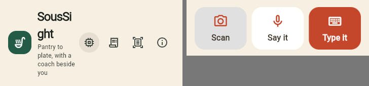

### A11Y-02 · HIGH · Moving to the next cook step is silent for screen readers — cook screen · [SS-114](#)

- **Steps:** Turn semantics on (screen reader running), open a recipe, and activate *Next step →*.
- **Result:**
  - The step card's text changes and the progress counter moves from "1 / 5" to "2 / 5".
  - Focus stays on *Next step →*.
  - Nothing is announced. Both live-region hosts stayed empty: a MutationObserver on every `aria-live`
    element recorded no text.
  - Starting the 5-minute timer is also silent.
  - A blind cook with busy hands has to swipe back up to find the new instruction.
- **WCAG:** 4.1.3 Status Messages (AA).
- **Evidence:** [02-step-change-silent.png](accessibility-audit/02-step-change-silent.png). Step 2 is shown;
  the screen reader announced nothing.
- **Suggested fix:** When the step changes, either
  - call `SemanticsService.announce('Step 2 of 5. Chop the tomato and onion. …', TextDirection.ltr)`, or
  - mark the step card `Semantics(liveRegion: true)`.

  Also announce "5-minute timer started" when a timer starts. Moving focus to the step title is an
  alternative, but announcing keeps the cook's place on the button.
- **What passed here:** timer *completion* is announced. A polite live region spoke "TIME TO CHECK. Let the
  flavors meld. Let the flavors meld timer finished. Check your food. 0:00" when the timer ran out
  (`lib/genui/cooking_catalog.dart`, `_TimerPanel`).

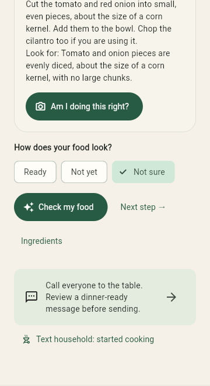

### A11Y-03 · MEDIUM · Keyboard focus lands off-screen or behind the Coach Lite box — home, cook · [SS-115](#)

- **Steps, cook screen:** Scroll to the bottom and open *Review dinner message*. Press Escape.
- **Result, cook screen:** Focus goes back to the *Review dinner message* button at y = 710–758, which sits
  fully behind the sticky Coach Lite box (y = 660–780). The page does not scroll it into view.
- **Steps, home:** Press Tab 15 times, past the last recipe card, so focus wraps to the header.
- **Result, home:** The next eight focus stops (the header icons, *Set up on-device AI*, Scan, Say it,
  Type it) are about 600 px above the viewport. The page stays scrolled to the bottom, so the user sees no
  focus at all.
- **WCAG:** 2.4.11 Focus Not Obscured (Minimum) (AA, WCAG 2.2); 2.4.7 Focus Visible (AA).
- **Evidence:** [05-focus-hidden.png](accessibility-audit/05-focus-hidden.png). Left: after Escape, focus is
  under the composer. Right: home after the Tab wrap; nothing focused is visible.
- **Suggested fix:**
  - Let focus changes scroll the focused control into view, using `Scrollable.ensureVisible` from a
    `Focus(onFocusChange:)` or from the dialog's close handler.
  - Leave room for the composer at the bottom of the cook screen's scroll view. Padding equal to the
    composer's height, or `MediaQuery.viewPadding`, lets `ensureVisible` keep controls above it.

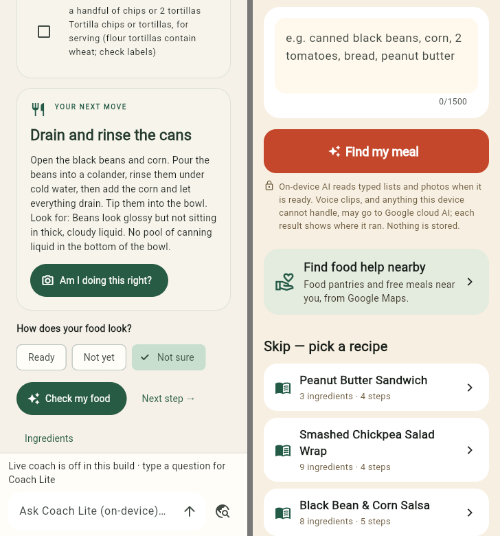

### A11Y-04 · MEDIUM · The Coach Lite box keeps re-entering the Tab order — cook screen · [SS-116](#)

- **Steps:** Open a recipe and Tab from the top.
- **Result:** The sequence runs:
  - *Back to pantry* → *New cook* → the four header icons
  - → **Ask Coach Lite → Send → Research**
  - → *Watch my food* → **Ask Coach Lite → Send → Research**
  - → the first seven ingredients → **Ask Coach Lite**
  - → the last ingredient → **Ask Coach Lite → Send → Research**
  - → *Am I doing this right?* …

  The composer comes up 4–5 times per pass, between content sections, because traversal follows on-screen
  position and the composer is pinned to the bottom. *New cook* also needs two Tab presses (stops 2 and 3).
- **WCAG:** 2.4.3 Focus Order (A).
- **Evidence:** [04-composer-tab-order.png](accessibility-audit/04-composer-tab-order.png). Tab 7 is on
  *How it works*; Tab 8 jumps into the composer at the bottom.
- **Suggested fix:** Wrap the scrolling content and the composer in separate `FocusTraversalGroup`s, so the
  composer is reached once, after the content. Alternatively, give the composer an `OrderedTraversalPolicy` /
  `FocusTraversalOrder` that puts it last.

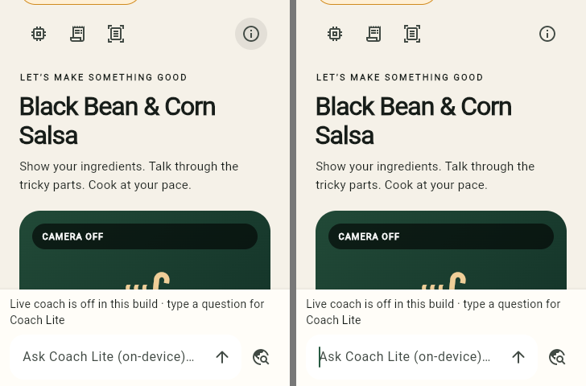

### A11Y-05 · MEDIUM · No headings or landmarks on the home and cook screens · [SS-117](#)

- **Steps:** Turn semantics on and list `h1–h6`, `[role=heading]` and landmark roles in the DOM.
- **Result:**
  - **Zero headings** on home and on the cook screen.
  - Text that looks like a heading is plain text to a screen reader: "What did you get from the pantry?",
    "Skip — pick a recipe", the recipe name, "Your cooking space", "On your counter", and each step title.
  - No `main` or `region` landmarks; axe reports `region` on every screen.
  - A screen-reader user can't jump to "the current step" or "ingredients" and has to swipe through every
    element.
  - The sheets already do this right: How it works, What was sent and On-device AI expose `<h2>` headings.
- **WCAG:** 1.3.1 Info and Relationships (A); 2.4.1 Bypass Blocks (A); 2.4.6 Headings and Labels (AA).
- **Evidence:** [03-no-headings.png](accessibility-audit/03-no-headings.png). Text styled as headings, none of
  it exposed as a heading.
- **Suggested fix:**
  - Add `Semantics(header: true, …)` to the screen titles and section titles, plus `headingLevel` where the
    Flutter version supports it. Places: `pantry_screen.dart` (hero title, "Skip — pick a recipe") and
    `cooking_app.dart` (recipe name, "Your cooking space", ingredients title, step title).
  - Optionally use `Semantics(container: true, explicitChildNodes: true)` with a label to group the main
    regions.

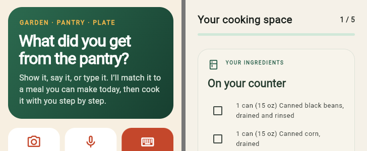

### A11Y-06 · MEDIUM · Semantics are off by default, so voice control and automated checks see an empty page — all screens · [SS-118](#)

- **Steps:** Load the site and look at the DOM before any assistive technology acts.
- **Result:**
  - The only accessible element is `<flt-semantics-placeholder role="button" aria-label="Enable accessibility">`,
    1×1 px at (−1, −1). There are 0 `flt-semantics` nodes.
  - Screen readers that find and press that button get the full tree.
  - Voice-control users (macOS Voice Control, Dragon) and switch users don't: "Click Scan" has nothing to
    target.
  - Lighthouse and axe likewise score the empty page 100 / 0 violations (44 Lighthouse audits not applicable).
    A judge who runs Lighthouse sees a number that proves nothing.
- **WCAG:** 4.1.2 Name, Role, Value (A), for anything that doesn't press the placeholder; 2.5.3 Label in Name
  (A), for voice control.
- **Evidence:** [06-lighthouse-hollow-100.png](accessibility-audit/06-lighthouse-hollow-100.png).
- **Suggested fix:** On web, call `SemanticsBinding.instance.ensureSemantics()` once at startup, in `main()`
  behind `kIsWeb`. The cost is some performance on large trees; measure on a low-end Android phone. Then re-run
  Lighthouse/axe; they will start reporting real issues (e.g. A11Y-05).

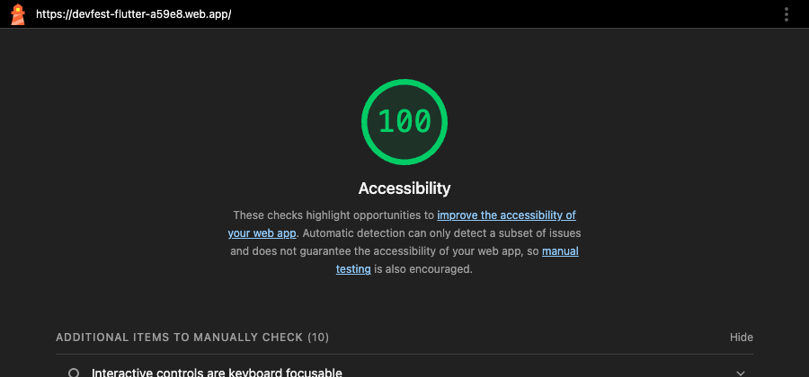

### A11Y-07 · MEDIUM · At 200% text the title breaks mid-word and the Coach Lite box cuts off text — home, cook · [SS-119](#)

- **Steps:** Set Chrome's font size to 32 px (*Settings → Appearance → Font size*, or `html { font-size: 32px }`
  before load; Flutter reads it as 2.0× text scale), then reload at 360 px.
- **Result:**
  - The home header shows **"So / usS / ight"** over three lines, and the tagline wraps one word per line.
    Even at 100% the title already breaks as "SousSi / ght" at 360 px.
  - On the cook screen, the sticky composer grows to about 235 px, roughly 30% of the screen. Its notice is cut
    to "Live coach is off in this build · type a question f…" and its hint to "Ask Coach Lite (on-device)…",
    because of `maxLines: 2` with ellipsis (`cooking_app.dart` around line 941).
  - The rest of the screens reflow without loss.
- **WCAG:** 1.4.4 Resize Text (AA). Content is lost at 200%.
- **Evidence:** [07-text-200.png](accessibility-audit/07-text-200.png). Left: home at 200%. Right: cook screen
  at 200%.
- **Suggested fix:**
  - Let the title shrink or wrap at word boundaries: `FittedBox(fit: BoxFit.scaleDown)`, or move the header
    icons to a second row below about 400 px.
  - In the composer, drop `maxLines`/ellipsis on the notice (or hide the notice when text scale > 1.3) and
    let the field grow.
  - Related: SS-107 (Kitchen mode, big text) should test at 200% too.

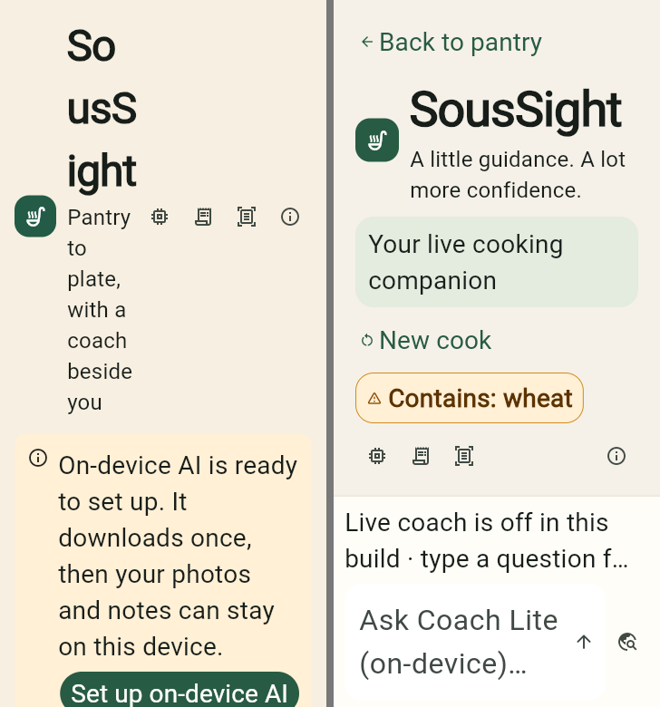

### A11Y-08 · MEDIUM · The pantry text field has no lasting label — home · [SS-120](#)

- **Steps:** On home, focus the text field and type "rice, canned tuna".
- **Result:**
  - Before typing, the field's accessible name is its example text: "e.g. canned black beans, corn, 2 tomatoes,
    bread, peanut butter".
  - After typing, Flutter removes the `aria-label`. The only name left is that same placeholder example, and
    nothing visible says what the field is for.
  - A screen reader announces an example list, not "What's in your pantry".
- **WCAG:** 3.3.2 Labels or Instructions (A); 1.3.1 Info and Relationships (A).
- **Evidence:** [09-field-label.png](accessibility-audit/09-field-label.png). After typing, there is no label.
- **Suggested fix:** Give the `TextField` in `pantry_screen.dart` (around line 790) a
  `labelText: 'What you have'` (or a visible label above it), and keep the example as `hintText`.

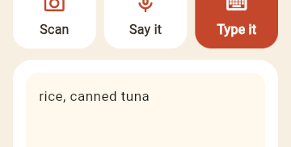

### A11Y-09 · MEDIUM · The yellow "GARDEN · PANTRY · PLATE" text fails contrast on the green hero — home · [SS-121](#)

- **Steps:** Look at the hero card on home at desktop width.
- **Result:**
  - The 12 px, w800 text is in `pantryMustard` `#F2B84B` on a gradient that runs from `#2C6A4F` (top-left,
    where the text sits) to `#173F30`.
  - The token pair is **3.58:1**. On-screen pixels measured 4.29:1 at 1440 px and 4.88:1 at 360 px (the text
    lands on a darker part of the gradient on phones).
  - Small text needs 4.5:1.
- **WCAG:** 1.4.3 Contrast (Minimum) (AA).
- **Evidence:** [08-eyebrow-contrast.png](accessibility-audit/08-eyebrow-contrast.png) (1440 px).
- **Suggested fix:** Either lighten the text to `#F9D68E` (4.58:1 on `#2C6A4F`), or start the gradient at
  `#1F513D` (5.10:1 with the current `#F2B84B`) in `pantry_screen.dart` `_hero()`. `#235B46` is not dark
  enough: it gives 4.42:1.

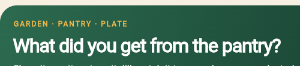

### A11Y-10 · LOW · The "How does your food look?" choices are read as checkboxes — cook screen · [SS-122](#)

- **Steps:** Turn semantics on and inspect *Ready / Not yet / Not sure*.
- **Result:** Each is exposed as `role=checkbox` with `aria-checked`. "Not sure" starts checked. The choice is
  single-select, but a screen reader says "checkbox, checked" and gives no group name.
- **WCAG:** 4.1.2 Name, Role, Value (A); 1.3.1 Info and Relationships (A).
- **Evidence:** [10-chips-as-checkboxes.png](accessibility-audit/10-chips-as-checkboxes.png).
- **Suggested fix:** Wrap the `ChoiceChip`s (`cooking_app.dart` around line 1143) in
  `Semantics(container: true, label: 'How does your food look?')`, and give each chip
  `Semantics(inMutuallyExclusiveGroup: true, selected: …)` so it is exposed as a radio button.

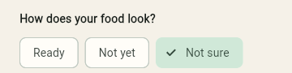

### A11Y-11 · LOW · The step progress bar announces a bare number — cook screen · [SS-123](#)

- **Steps:** On step 3 of 5, inspect the progress bar under "Your cooking space".
- **Result:** `role=progressbar aria-valuenow=40 aria-label="40"`. A screen reader says "40, progress bar",
  with no unit or context. The "3 / 5" text next to it is a separate node.
- **WCAG:** 4.1.2 Name, Role, Value (A); 1.3.1 (A).
- **Evidence:** [11-progress-label.png](accessibility-audit/11-progress-label.png).
- **Suggested fix:** Give the `LinearProgressIndicator` (`cooking_app.dart` around line 1070)
  `semanticsLabel: 'Cooking progress'` and `semanticsValue: '2 of 5 steps done'`, or merge it with the
  "3 / 5" text as "Step 3 of 5".

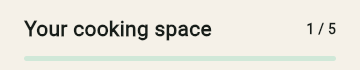

### A11Y-12 · LOW · The allergen chip is 44 px tall — cook screen header · [SS-124](#)

- **Steps:** Open a recipe that contains wheat and measure the *Contains: wheat* chip.
- **Result:** 152×44 px. WCAG 2.5.8 (24 px) and 2.5.5 AAA (44 px) pass, but the chip misses the card's
  48 px bar. Every other control checked was at least 48 px.
- **WCAG:** none failed. This is the card's 48 px requirement (Material/Android guidance).
- **Evidence:** [12-allergen-chip.png](accessibility-audit/12-allergen-chip.png).
- **Suggested fix:** Give the chip in `lib/learner/allergen_chip.dart` `materialTapTargetSize:
  MaterialTapTargetSize.padded`, or a 48 px minimum height.

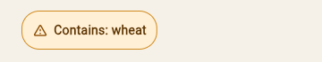

## What passed

- **Keyboard reachability:** every control in the journey can be reached with Tab. Enter activates a focused
  recipe card with semantics off. The home Tab order matches reading order (header → banner → Scan / Say it /
  Type it → field → *Find my meal* → nearby → recipes).
- **Names:** every icon-only button has a name: *On-device AI*, *What was sent*, *Check a label*, *How it
  works*, *Send message*, *Research a cooking question*. The allergen chip says "Allergens. Contains: wheat.
  Tap for label advice."
- **Ingredients:** they are real checkboxes, with their state exposed.
- **Dinner review dialog:**
  - It is exposed as `alertdialog`.
  - Tab cycles only within it (Close → Simulate failed delivery → Confirm simulated send).
  - Escape closes it and returns focus to the button that opened it (but see A11Y-03).
  - "Simulated — no SMS sent" and "Recipient: Demo household (fictional)" are in the text at 14:1.
- **Sheets:** How it works, What was sent, On-device AI and Check a label all expose `<h2>` headings. Escape
  closes each one, and the first Tab lands on *Dismiss*.
- **Timer:** the countdown isn't a live region, so it doesn't speak every second. Completion is announced
  politely.
- **Text contrast:** all body and button text measured at least 4.5:1, apart from A11Y-09. Examples:
  - `#285B43` on cream: 6.98:1
  - white on `#C4472B` (*Type it*, *Find my meal*): 4.90:1
  - note text `#6B5A3E` on `#F7EFE1`: 5.82:1
  - field hint `#404943` on `#FFF8EC`: 8.83:1
  - icon glyphs `#404943`: 8.2:1
- **Touch targets:** header icon buttons 48×48. Scan / Say it / Type it 103×84. Food-look chips 73–108×48.
  Ingredient rows at least 48 tall. Composer buttons 48×48. Dinner dialog buttons 48 tall. The only one under
  48 is A11Y-12.
- **Motion:**
  - With `prefers-reduced-motion: reduce`, Flutter sets `disableAnimations` and the sheets open instantly.
    Measured: frames identical to the settled frame from about 100 ms, against about 230 ms of animation
    without the setting.
  - There is no looping, flashing or auto-moving decorative content; the only animations are loading
    spinners and route/sheet transitions.
- **Reflow at 100%:** no horizontal scrolling at 360 px. The viewport meta allows zoom up to 5×.
- **Page basics:** `lang="en-US"` and `<title>SousSight</title>`.

## What a person still needs to check

This audit read the semantics DOM that Flutter produces. It did not listen to a real screen reader. Before
calling the app screen-reader ready, someone should run the hero journey with:

- **TalkBack on Android Chrome** (the main delivery target). Check that:
  - the "Enable accessibility" placeholder is found and activated by a swipe;
  - swipe order matches the Tab order above;
  - double-tap works on canvas-backed buttons;
  - the timer-finished announcement is actually spoken;
  - typing in the pantry field works with TalkBack's keyboard.
- **VoiceOver on iOS Safari and macOS** (Safari and Chrome): the same checks, plus rotor navigation by
  headings once A11Y-05 is fixed.
- **NVDA or JAWS on Windows Chrome:** check that browse mode doesn't hide the Flutter tree, and that
  `alertdialog` is announced on open.
- **Voice Control (macOS/iOS) and Switch Access (Android):** these depend on A11Y-06.
- **The skipped camera, mic and cloud steps** (Scan, Say it, Watch my food, *Check my food*, *Find my meal*,
  Research, Coach Lite). Check permission-denied and error states for announcements and focus, on a device
  where those features can run.
- **Long sessions:** a long "What was sent" ledger, to confirm keyboard scrolling (axe
  `scrollable-region-focusable`).

## How the automated runs were made

```sh
npx lighthouse@12 https://devfest-flutter-a59e8.web.app/ --only-categories=accessibility \
  --form-factor=mobile --screenEmulation.width=360 --screenEmulation.height=780 \
  --screenEmulation.deviceScaleFactor=2 --output=json --chrome-flags="--headless=new"
npx lighthouse@12 https://devfest-flutter-a59e8.web.app/ --only-categories=accessibility \
  --preset=desktop --output=json --chrome-flags="--headless=new"
```

axe ran with `@axe-core/puppeteer` (tags `wcag2a, wcag2aa, wcag21a, wcag21aa, wcag22aa, best-practice`)
against headless Chrome, before and after
`document.querySelector('flt-semantics-placeholder').click()`. Keyboard order came from pressing Tab and
reading `document.activeElement`. Contrast came from screenshot pixels inside each semantics node's rectangle:
the most common colour is taken as the background, and the colour with the highest contrast against it is
compared, then checked against source colour tokens. Text at 200% was set with `html { font-size: 32px }`
before Flutter started.
